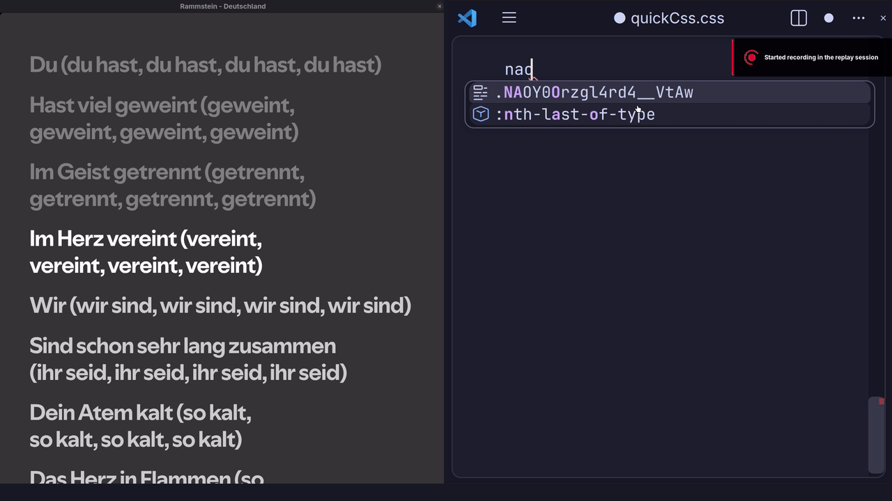

# Spicetify QuickCSS



A lightweight, zero-dependency **Spicetify extension** for live-reloading custom CSS in Spotify without restarting the client. **Why QuickCSS instead of built-in Snippets?** - They are lacks for active development because editing inside the built-in modal lacks syntax highlighting, autosuggestion, formatting, and proper search/replace.

## Features

* **Instant Hot-Reload:** Automatically polls your selected `.css` file and injects changes on file save.
* **Persistent Cache:** Saves your latest CSS into `localStorage` so styles apply immediately on startup.
* **Priority Override:** Uses a `MutationObserver` to ensure your rules take precedence over theme styles.
* **Zero Dependencies:** Written in pure vanilla JavaScript utilizing the native **File System Access API**.

## Installation

Make sure you have **Spicetify client** installed, then:

1. Download `quickCss.js` from this repository.
2. Place the script into your Extensions folder:
    * **Windows:** `%appdata%/spicetify/Extensions/`
    * **Linux/macOS:** `~/.config/spicetify/Extensions/`
3. Enable the extension and apply Spicetify changes:
    ```sh
    spicetify config extensions quickCss.js
    spicetify apply
    ```

## Usage

**This extension does not include any built-in themes** - it is strictly a loader utility. You need to provide your own `.css` file to apply any visual changes (or test it with the [example patch](quickCss.css) for **Hazy Theme**).

1. Focus the Spotify window and press `Ctrl+Shift+O`.
2. Select your local `.css` file from the file picker dialog.
3. A toast notification (`QuickCSS loaded: <filename>.css`) will confirm is loaded.
4. Edit and save the file in your preferred editor - Spotify will update automatically.

## Quick Guide

If your new to styling Spotify, here is how to inspect elements and write first rules:

1. **Create a `.css` file** anywhere in your user directory (e.g. `Documents/spotify.css`)
2. **Enable Developer Tools** in Spotify by running this command in your terminal once:
    ```sh
    spicetify enable-devtools # Note: applies only to the current session
    ```
3. **Inspect Spotify's UI:** Press `Ctrl+Shift+I` inside Spotify to open Chrome DevTools. Use the element picker (`Ctrl+Shift+C`) to click on any button, panel, or text and see its classes or `data-testid` attributes.
4. **Write and save rules:** Spotify uses inline styles, so you will usually need `!important` to override them:
    ```css
    /* Example: Stretch the playback bar at the top of the panel */

    .main-nowPlayingBar-container {
        position: relative !important;
    }

    .playback-bar {
        top: 8px !important;
        width: 100% !important;
        position: absolute !important;
    }

    [data-testid^="playback-position"],
    [data-testid^="playback-duration"] {
        display: none !important;
    }
    ```
5. **Tip for stable selectors:** Prefer `.main-...` and `[data-testid="..."]` over randomized hash classes (like `.NAOYOOrzgl4rd4__VtAw`), as hash classes change after Spotify updates.

*You can also check the included [example file](quickCss.css) - custom layout styling patch specifically tailored for the **Hazy Theme**.*

## Limitations

* **Restricted Directories:** Due to **File System Access API** security sandbox, files can only be loaded from standard user directories (e.g. `Desktop`, `Documents`, `Downloads`) or a custom folder in your home.
* **Session Persistence:** While your CSS remains applied after a Spotify restart via `localStorage`, the active file handle is lost. Press `Ctrl+Shift+O` again and select file.
* **CSS Scope Specificity:** Just like built-in **Marketplace Snippets**, injected styles target the main Spotify UI and themes, and generally cannot style elements injected by other extensions.

## License

Copyright (c) 2026 b3hav1

This repository is licensed under the [MIT License](LICENSE).
